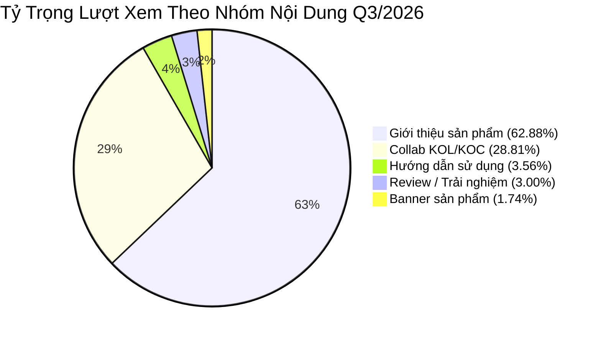
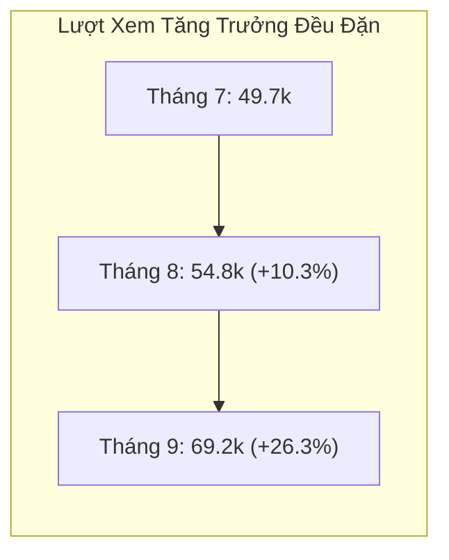
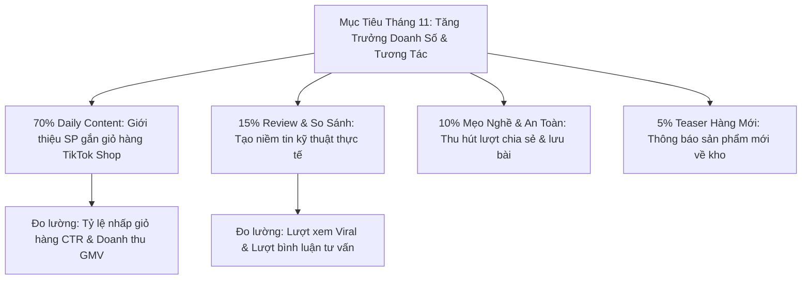

# 📊 BÁO CÁO TỔNG HỢP HIỆU QUẢ NỘI DUNG TIKTOK (Q3/2026)
### KÊNH TIKTOK THƯƠNG HIỆU: KING BLUE / CKO • THỜI GIAN ĐÁNH GIÁ: THÁNG 7 – THÁNG 9/2026

  
  
  
  
  
  

---

## 📑 MỤC LỤC BÁO CÁO

1. [Tóm Tắt Điều Hành (Executive Summary)](#1-tóm-tắt-điều-hành-executive-summary)
2. [Dashboard Chỉ Số Hiệu Suất Tổng Thể (KPI Overview)](#2-dashboard-chỉ-số-hiệu-suất-tổng-thể-kpi-overview)
3. [Phân Tích Tăng Trưởng Hàng Tháng (Monthly Growth Analysis)](#3-phân-tích-tăng-trưởng-hàng-tháng-monthly-growth-analysis)
4. [Phân Tích Hiệu Quả Theo 5 Nhóm Nội Dung (Content Pillar Analysis)](#4-phân-tích-hiệu-quả-theo-5-nhóm-nội-dung-content-pillar-analysis)
5. [Bảng Xếp Hạng Top Video Đột Phá (Top Performing Content)](#5-bảng-xếp-hạng-top-video-đột-phá-top-performing-content)
6. [Đánh Giá Insight & Bài Học Kinh Nghiệm (Key Insights)](#6-đánh-giá-insight--bài-học-kinh-nghiệm-key-insights)
7. [Kế Hoạch & Đề Xuất Phân Bổ Nội Dung Kỳ Tới (Action Plan Tháng 11)](#7-kế-hoạch--đề-xuất-phân-bổ-nội-dung-kỳ-tới-action-plan-tháng-11)
8. [Phụ Lục Dữ Liệu Chi Tiết 68 Video (Data Appendix)](#8-phụ-lục-dữ-liệu-chi-tiết-68-video-data-appendix)

---

## 1. TÓM TẮT ĐIỀU HÀNH (EXECUTIVE SUMMARY)

Trong giai đoạn Quý 3/2026 (Tháng 7 – Tháng 9), kênh TikTok đã triển khai **68 video**, ghi nhận tổng cộng **173.762 lượt xem**, **2.019 lượt thích** và **62 lượt bình luận**.

* 🚀 **Xu hướng tăng trưởng vượt bậc:** Lượt xem tăng liên tục qua từng tháng (Tháng 7: 49.7k ➔ Tháng 8: 54.8k ➔ Tháng 9: 69.2k). Đặc biệt trong Tháng 9, tương tác tăng trưởng đột biến: **Lượt thích tăng +365,4%** và **Bình luận tăng +583,3%**.
* 🌟 **Điểm sáng tăng trưởng (Growth Driver):** Nhóm nội dung **Collab KOL/KOC** chỉ chiếm **10% số lượng video (7 video)** nhưng mang lại **28,81% lượt xem** và chiếm tới **59,04% tổng tương tác** toàn kênh. Video *Combo điện lạnh (8/9)* là content viral nhất quý với **42.000 lượt xem** và **1.077 lượt thích**.
* ⚠️ **Vấn đề cần tối ưu:** 
  * Nhóm video **Giới thiệu sản phẩm thuần túy** chiếm tỷ trọng áp đảo (**75% video**), phục vụ tốt việc duy trì luồng nội dung và gắn link giỏ hàng TikTok Shop, nhưng tỷ lệ tương tác trung bình còn thấp (~13 tương tác/video).
  * Định dạng **Banner sản phẩm (ảnh tĩnh)** có hiệu suất kém nhất (trung bình ~1.010 views, 6 tương tác), cần cắt giảm tối đa để tránh bị thuật toán TikTok giảm phân phối.

---

## 2. DASHBOARD CHỈ SỐ HIỆU SUẤT TỔNG THỂ (KPI OVERVIEW)

| Chỉ Số Đo Lường (Metrics) | Kết Quả Thực Đạt (Q3/2026) | Ghi Chú & Tỷ Lệ Đóng Góp |
| :--- | :---: | :--- |
| **Tổng số video xuất bản** | **68 video** | Trung bình ~22.6 video / tháng (~5.2 video / tuần) |
| **Tổng lượt xem (Views)** | **173.762** | Trung bình 2.555 lượt xem / video |
| **Tổng lượt thích (Likes)** | **2.019** | Trung bình 29.7 lượt thích / video |
| **Tổng bình luận (Comments)** | **62** | Trung bình 0.91 bình luận / video |
| **Tỷ lệ tương tác chung (ER)** | **1.20%** | ER = (Likes + Comments) / Views |
| **Chiến dịch thành công nhất** | **Combo điện lạnh (Collab KOC)** | 42.000 views, 1.077 likes, 26 comments |

---

## 3. PHÂN TÍCH TĂNG TRƯỞNG HÀNG THÁNG (MONTHLY GROWTH ANALYSIS)

### Bảng tổng hợp so sánh qua 3 tháng

| Tháng | Số Video | Tổng Lượt Xem | TB Lượt Xem/Video | Tổng Lượt Thích | Tổng Bình Luận | Tỷ Lệ Tương Tác (ER) |
| :---: | :---: | :---: | :---: | :---: | :---: | :---: |
| **Tháng 7** | 25 | 49.699 | 1.988 | 368 | 15 | 0.77% |
| **Tháng 8** | 22 | 54.824 *(+10.31%)* | 2.492 | 292 *(-20.65%)* | 6 *(-60.00%)* | 0.54% |
| **Tháng 9** | 21 | 69.239 *(+26.29%)* | 3.297 | 1.359 *(+365.41%)* | 41 *(+583.33%)* | **2.02%** |
| **TỔNG CỘNG** | **68** | **173.762** | **2.555** | **2.019** | **62** | **1.20%** |

### Đánh giá nhịp độ theo từng tháng:
1. **Tháng 7/2026 (Giai đoạn xây dựng nền tảng):** Duy trì tần suất đăng bài cao nhất (25 video/tháng). Trọng tâm phủ sóng các dòng quạt mùa hè (KB-CF01, quạt sò lạnh), đầu siết tôn, kéo cắt nẹp điện. Tương tác ở mức ổn định sơ khởi.
2. **Tháng 8/2026 (Giai đoạn thử nghiệm sản phẩm mới):** Lượt xem tăng +10.31% nhờ các video kéo cắt cành (QC1, QC2, QC4) và hít kính điện tử. Tuy nhiên tương tác giảm do chủ yếu là video review sản phẩm ngắn đơn lẻ, thiếu câu hỏi kích thích bình luận.
3. **Tháng 9/2026 (Giai đoạn bùng nổ chuyển đổi & tương tác):** Bước ngoặt lớn khi đẩy mạnh nội dung **Collab KOC kỹ thuật** (máy thổi phản lực, máy khoan bê tông, siết bulon, combo điện lạnh). Lượt thích tăng gấp 4.6 lần, bình luận tăng gần 7 lần.

---

## 4. PHÂN TÍCH HIỆU QUẢ THEO 5 NHÓM NỘI DUNG (CONTENT PILLAR ANALYSIS)

| STT | Nhóm Nội Dung | Số Video | Tỷ Trọng Video | Tổng Lượt Xem | TB Lượt Xem/Video | Tỷ Trọng Lượt Xem | Tổng Tương Tác | TB Tương Tác/Video | Tỷ Trọng Tương Tác | Đánh Giá & Nhận Định Chiến Lược |
| :---: | :--- | :---: | :---: | :---: | :---: | :---: | :---: | :---: | :---: | :--- |
| **1** | **Giới thiệu sản phẩm** | 51 | 75.0% | 109.269 | 2.143 | 62.88% | 684 | 13 | 33.88% | **Trụ cột duy trì (Daily content):** Giữ nhịp đăng đều, mục tiêu chính là gắn link giỏ hàng TikTok Shop. |
| **2** | **Video / Collab KOL/KOC** | 7 | 10.3% | 50.061 | **7.152** | 28.81% | **1.192** | **170** | **59.04%** | **Đòn bẩy tăng trưởng (Star Content):** Lượt xem TB gấp 3.3 lần, tương tác TB gấp 13 lần nhóm thường! |
| **3** | **Review / Trải nghiệm thực tế** | 3 | 4.4% | 5.215 | 1.738 | 3.00% | 74 | 25 | 3.67% | Tương tác ở mức trung bình khá, cần nâng cao tính thực chiến khi test sản phẩm. |
| **4** | **Hướng dẫn sử dụng** | 4 | 5.9% | 6.188 | 1.547 | 3.56% | 52 | 13 | 2.58% | Tương tác thấp; cần đổi format dạng mẹo vặt thợ nghề (Tips & Tricks) thay vì sách hướng dẫn khô cứng. |
| **5** | **Banner sản phẩm** | 3 | 4.4% | 3.029 | 1.010 | 1.74% | 17 | 6 | 0.84% | **Kém hiệu quả nhất:** Thuật toán video ngắn không ưu tiên ảnh tĩnh ghép nhạc, nên cắt giảm. |
| | **TỔNG CỘNG** | **68** | **100%** | **173.762** | **2.555** | **100%** | **2.019** | **29.7** | **100%** | |

---

## 5. BẢNG XẾP HẠNG TOP VIDEO ĐỘT PHÁ (TOP PERFORMING CONTENT)

Dưới đây là danh sách các video có số liệu vượt trội nhất trong cả Quý 3/2026:

| Top | Ngày Đăng | Tên / Chủ Đề Video | Nhóm Nội Dung | Thời Lượng | Lượt Xem | Lượt Thích | Bình Luận | Yếu Tố Tạo Nên Thành Công |
| :---: | :---: | :--- | :--- | :---: | :---: | :---: | :---: | :--- |
| 🥇 **1** | 08/09/2026 | **Combo điện lạnh** | Collab KOL/KOC | 1m48s | **42.000** | **1.077** | **26** | Đánh trúng nhu cầu trọn bộ nghề của thợ điện lạnh, KOC uy tín review thực tế. |
| 🥈 **2** | 11/08/2026 | **Các loại kéo cắt cành** | Giới thiệu sản phẩm | 48s | **12.000** | **34** | **0** | Đánh vào thị hiếu nhà nông/làm vườn, so sánh nhiều mẫu kéo đa dạng trong 1 clip. |
| 🥉 **3** | 09/07/2026 | **Top 3 mẫu khò ga đáng mua** | Giới thiệu sản phẩm | 1m13s | **7.369** | **46** | **3** | Dạng nội dung "Top list gợi ý" kích thích người xem xem hết để chọn mẫu phù hợp. |
| **4** | 08/08/2026 | **Dao cắt trái cây QC1** | Giới thiệu sản phẩm | 26s | **7.363** | **18** | **0** | Nhỏ gọn, thị phạm cắt gọt sắc bén trực quan, thời lượng ngắn dễ cắn đề xuất. |
| **5** | 26/09/2026 | **Thùng đồ nghề KHD4233** | Giới thiệu sản phẩm | 38s | **4.967** | **21** | **7** | Thiết kế thông minh nhiều ngăn, đánh đúng tâm lý thích xếp đồ nghề của anh em thợ. |
| **6** | 18/08/2026 | **Hít kính điện tử** | Giới thiệu sản phẩm | 42s | **4.766** | **38** | **1** | Sản phẩm công nghệ mới lạ, tính năng hít tự động gây tò mò thị giác cao. |
| **7** | 21/07/2026 | **Công cụ hỗ trợ lắp ráp ống đồng** | Giới thiệu sản phẩm | 55s | **4.479** | **12** | **0** | Thiết bị chuyên dụng giải quyết điểm nghẽn thao tác cho thợ điều hòa. |

---

## 6. ĐÁNH GIÁ INSIGHT & BÀI HỌC KINH NGHIỆM (KEY INSIGHTS)

### 💡 1. Sức mạnh đòn bẩy của KOL/KOC chuyên ngành kỹ thuật
* Dữ liệu chứng minh các video hợp tác KOC mang lại lượt tương tác cao gấp **13 lần** video tự sản xuất. Thợ cơ khí và điện lạnh có xu hướng tin tưởng trải nghiệm thực chiến của đồng nghiệp hơn là lời quảng cáo một chiều từ nhãn hàng.
* *Hành động:* Cần duy trì ngân sách cố định cho mạng lưới KOC hạt nhân (như Nam Thợ Đụng, Tấn Tài, Trí Điện Lạnh...).

### 💡 2. Định dạng nội dung "Combo đồ nghề theo chuyên ngành" có tỷ lệ chuyển đổi cao nhất
* Video đạt đỉnh cao nhất là **"Combo điện lạnh" (42.000 views)**. Khách hàng B2B và thợ nghề rất thích giải pháp trọn gói (bơm lốp + khò ga + bộ loe ống + máy pin), giúp họ tiết kiệm thời gian chọn lẻ.
* *Hành động:* Xây dựng thêm các video "Combo cơ khí hàn xì", "Combo thợ nhôm kính", "Combo thợ mộc/nội thất".

### 💡 3. Thời lượng video vàng trên TikTok
* Các video ngắn dưới **30 - 45 giây** có tỷ lệ giữ chân người xem tốt nhất khi giới thiệu tính năng đơn lẻ.
* Các video review chuyên sâu hoặc Collab KOC nên duy trì độ dài từ **1 phút đến 1 phút 45 giây** để đủ thời lượng thị phạm thực tế mà không bị ngắt quãng trải nghiệm.

### 💡 4. Loại bỏ hoàn toàn định dạng ảnh tĩnh / Banner
* Video banner dạng slide ảnh đạt kết quả rất thấp (~1.000 views và dưới 10 tương tác). Kênh TikTok là nền tảng video chuyển động (Motion Video), cần ngưng sản xuất dạng slide ảnh để bảo toàn điểm chất lượng của tài khoản.

---

## 7. KẾ HOẠCH & ĐỀ XUẤT PHÂN BỔ NỘI DUNG KỲ TỚI (ACTION PLAN THÁNG 11)

Theo định hướng tối ưu hóa chi phí và mục tiêu kinh doanh trên TikTok Shop:

| Nhóm Nội Dung Đề Xuất | Tỷ Trọng Đề Xuất | Số Video Dự Kiến | Ước Tính Lượt Xem | Trọng Tâm Triển Khai |
| :--- | :---: | :---: | :---: | :--- |
| **Giới thiệu sản phẩm** | **70%** | **17 video** | **36.423 views** | Tập trung dải máy pin mới (máy mài K18MGS, máy khoan K18QES, máy rửa xe KBA-I1500); gắn link giỏ hàng trực tiếp. |
| **Review / So sánh thực tế** | **15%** | **4 video** | **28.606 views** | Test đè tải, so sánh máy pin vs máy điện, test va đập máy cân bằng laser. |
| **Hướng dẫn sử dụng / Mẹo nghề** | **10%** | **2 video** | **3.094 views** | Mẹo bảo dưỡng pin không chai, quy tắc an toàn chống lật cổ tay khi mài. |
| **Banner / Teaser hàng mới** | **5%** | **1 video** | **1.010 views** | Chỉ áp dụng video motion ngắn dưới 15s cho thông báo hàng mới về kho. |
| **TỔNG KẾ HOẠCH THÁNG 11** | **100%** | **24 video** | **~69.133 views** | **Mục tiêu: Đạt tỷ lệ tương tác ER > 2.5%** |

---

## 8. PHỤ LỤC DỮ LIỆU CHI TIẾT 68 VIDEO (DATA APPENDIX)

<b>👉 Nhấn vào đây để xem toàn bộ danh sách 25 video Tháng 7/2026</b>

| Ngày Đăng | Tên / Chủ Đề Video | Nhóm Nội Dung | Thời Lượng | Lượt Xem | Lượt Thích | Bình Luận |
| :---: | :--- | :--- | :---: | :---: | :---: | :---: |
| 01/07/2026 | Đầu siết tôn tích hợp bi giữ | Giới thiệu sản phẩm | 37s | 1.239 | 14 | 0 |
| 02/07/2026 | Đầu siết tôn tích hợp bi giữ | Giới thiệu sản phẩm | 34s | 1.641 | 9 | 0 |
| 03/07/2026 | Bộ sưu tập quạt cầm tay | Giới thiệu sản phẩm | 44s | 806 | 5 | 0 |
| 04/07/2026 | Đầu siết tôn ST08X42V | Giới thiệu sản phẩm | 36s | 1.268 | 14 | 0 |
| 06/07/2026 | Kéo cắt góc nẹp điện KPQ-032 | Giới thiệu sản phẩm | 25s | 2.439 | 22 | 0 |
| 07/07/2026 | Quạt tích điện KB-CF01 | Giới thiệu sản phẩm | 38s | 2.801 | 12 | 0 |
| 09/07/2026 | Top 3 mẫu khò ga đáng mua | Giới thiệu sản phẩm | 1m13s | 7.369 | 46 | 3 |
| 10/07/2026 | Quạt cầm tay tích hợp sò lạnh | Giới thiệu sản phẩm | 42s | 1.477 | 19 | 1 |
| 11/07/2026 | Đầu siết tôn ST08X42V | Review / trải nghiệm thực tế | 43s | 2.364 | 28 | 6 |
| 13/07/2026 | Quạt cầm tay tích hợp sò lạnh | Review / trải nghiệm thực tế | 41s | 1.750 | 33 | 3 |
| 14/07/2026 | Quạt cầm tay tích hợp sò lạnh | Giới thiệu sản phẩm | 25s | 2.480 | 5 | 0 |
| 15/07/2026 | Quạt mini KB-HS | Giới thiệu sản phẩm | 25s | 2.118 | 3 | 0 |
| 16/07/2026 | Máy rung ốp lát gạch KM18-HR1 | Giới thiệu sản phẩm | 43s | 2.043 | 16 | 0 |
| 17/07/2026 | Bộ loe ống đồng | Hướng dẫn sử dụng | 29s | 3.082 | 22 | 1 |
| 18/07/2026 | Quạt mini KB-HS | Giới thiệu sản phẩm | 29s | 1.118 | 4 | 0 |
| 21/07/2026 | Công cụ hỗ trợ lắp ráp ống đồng | Giới thiệu sản phẩm | 55s | 4.479 | 12 | 0 |
| 22/07/2026 | Quạt cầm tay sò lạnh | Giới thiệu sản phẩm | 40s | 1.188 | 12 | 0 |
| 23/07/2026 | Máy mài góc K18MGS | Giới thiệu sản phẩm | 43s | 1.099 | 7 | 0 |
| 24/07/2026 | Quạt tích điện KB-CF01 | Giới thiệu sản phẩm | 28s | 564 | 5 | 0 |
| 25/07/2026 | Top những máy khoan đáng mua | Giới thiệu sản phẩm | 1m07s | 2.308 | 28 | 0 |
| 27/07/2026 | Máy cân bằng KB-05XS | Giới thiệu sản phẩm | 33s | 1.474 | 15 | 0 |
| 28/07/2026 | Tính năng máy mài góc | Giới thiệu sản phẩm | 41s | 1.091 | 13 | 0 |
| 29/07/2026 | Bộ mũi khoan đa năng | Giới thiệu sản phẩm | 44s | 849 | 7 | 1 |
| 30/07/2026 | Tuốt nơ vít 2 đầu | Giới thiệu sản phẩm | 34s | 2.083 | 12 | 0 |
| 31/07/2026 | Quạt cầm tay mini KB-HS | Giới thiệu sản phẩm | 19s | 569 | 5 | 0 |
| **TỔNG** | **25 Videos** | | | **49.699** | **368** | **15** |

<b>👉 Nhấn vào đây để xem toàn bộ danh sách 22 video Tháng 8/2026</b>

| Ngày Đăng | Tên / Chủ Đề Video | Nhóm Nội Dung | Thời Lượng | Lượt Xem | Lượt Thích | Bình Luận |
| :---: | :--- | :--- | :---: | :---: | :---: | :---: |
| 01/08/2026 | Ảnh banner máy cân bằng KB-05XS | Banner sản phẩm | - | 1.149 | 4 | 0 |
| 04/08/2026 | Kìm tuốt dây điện KND205 | Giới thiệu sản phẩm | 34s | 951 | 8 | 0 |
| 06/08/2026 | Máy bắn vít K18VFS | Giới thiệu sản phẩm | 29s | 1.326 | 11 | 0 |
| 07/08/2026 | Bộ mũi khoan đa năng KLJ-015 | Giới thiệu sản phẩm | 27s | 1.338 | 6 | 0 |
| 08/08/2026 | Dao cắt trái cây QC1 | Giới thiệu sản phẩm | 26s | 7.363 | 18 | 0 |
| 10/08/2026 | Dao cắt ống KPC-032 | Giới thiệu sản phẩm | 29s | 2.705 | 19 | 0 |
| 11/08/2026 | Các loại kéo cắt cành | Giới thiệu sản phẩm | 48s | 12.000 | 34 | 0 |
| 12/08/2026 | Kéo cắt cành QC4 | Giới thiệu sản phẩm | 26s | 1.254 | 7 | 0 |
| 13/08/2026 | Kéo cắt cành QC2 | Giới thiệu sản phẩm | 23s | 1.804 | 7 | 0 |
| 14/08/2026 | Máy hút chân không về hàng | Giới thiệu sản phẩm | 37s | 2.505 | 6 | 0 |
| 15/08/2026 | Máy bắn vít cấp trượt KB16VA2 | Giới thiệu sản phẩm | 29s | 1.485 | 10 | 2 |
| 17/08/2026 | Hít kính điện tử | Giới thiệu sản phẩm | 33s | 2.834 | 25 | 0 |
| 18/08/2026 | Hít kính điện tử | Giới thiệu sản phẩm | 42s | 4.766 | 38 | 1 |
| 19/08/2026 | Đèn pin siêu sáng | Giới thiệu sản phẩm | 27s | 544 | 3 | 0 |
| 22/08/2026 | Kéo cắt cành QC1 | Giới thiệu sản phẩm | 32s | 2.493 | 8 | 0 |
| 24/08/2026 | Hít kính điện tử | Giới thiệu sản phẩm | 1m14s | 3.163 | 32 | 2 |
| 25/08/2026 | Tổng hợp các mẫu hít kính hot | Giới thiệu sản phẩm | 1m20s | 1.294 | 7 | 0 |
| 26/08/2026 | Máy thổi phản lực | Review / trải nghiệm thực tế | 17s | 1.101 | 13 | 0 |
| 27/08/2026 | Máy khoan bê tông | Giới thiệu sản phẩm | 35s | 746 | 6 | 0 |
| 28/08/2026 | Trọn bộ hàng hot | Banner sản phẩm | - | 1.282 | 8 | 0 |
| 29/08/2026 | Máy thổi phản lực | Hướng dẫn sử dụng | 47s | 1.739 | 16 | 0 |
| 31/08/2026 | Hít kính điện tử | Video KOL/KOC | 1m09s | 982 | 6 | 1 |
| **TỔNG** | **22 Videos** | | | **54.824** | **292** | **6** |

<b>👉 Nhấn vào đây để xem toàn bộ danh sách 21 video Tháng 9/2026</b>

| Ngày Đăng | Tên / Chủ Đề Video | Nhóm Nội Dung | Thời Lượng | Lượt Xem | Lượt Thích | Bình Luận |
| :---: | :--- | :--- | :---: | :---: | :---: | :---: |
| 03/09/2026 | Test Máy thổi phản lực | Collab KOL/KOC | 1m37s | 1.384 | 13 | 0 |
| 04/09/2026 | Test Máy khoan bê tông | Collab KOL/KOC | 1m30s | 1.194 | 18 | 0 |
| 05/09/2026 | Test máy siết bulon | Video KOL/KOC | 1m59s | 1.173 | 10 | 0 |
| 07/09/2026 | Test thực tế máy siết bulon | Collab KOL/KOC | 1m24s | 2.222 | 52 | 0 |
| 08/09/2026 | Combo điện lạnh | Collab KOL/KOC | 1m48s | **42.000** | **1.077** | **26** |
| 09/09/2026 | Máy rửa xe tiêu âm KBA-US1500 | Giới thiệu sản phẩm | 50s | 2.980 | 30 | 1 |
| 10/09/2026 | Test Máy khoan bê tông | Video KOL/KOC | 51s | 1.106 | 16 | 2 |
| 12/09/2026 | Tổng hợp máy rửa xe | Banner sản phẩm | - | 598 | 5 | 0 |
| 14/09/2026 | Máy rửa xe KBA-UL1200 | Giới thiệu sản phẩm | 39s | 3.065 | 19 | 0 |
| 15/09/2026 | Máy thổi phản lực | Hướng dẫn sử dụng | 58s | 595 | 7 | 1 |
| 16/09/2026 | Bộ 3 máy khoan 3 chức năng | Giới thiệu sản phẩm | 1m34s | 893 | 12 | 0 |
| 17/09/2026 | Máy rửa xe áp lực KBA-UL1200 | Giới thiệu sản phẩm | 36s | 1.851 | 10 | 0 |
| 18/09/2026 | Máy rửa xe KBA-I1500 | Giới thiệu sản phẩm | 45s | 553 | 5 | 1 |
| 19/09/2026 | Máy rửa xe tiêu âm KBA-US1500 | Giới thiệu sản phẩm | 30s | 892 | 15 | 3 |
| 21/09/2026 | Máy thổi phản lực | Giới thiệu sản phẩm | 34s | 641 | 8 | 0 |
| 22/09/2026 | Bơm lốp kích bình | Giới thiệu sản phẩm | 42s | 470 | 3 | 0 |
| 23/09/2026 | Máy rửa xe tiêu âm KBA-US1500 | Giới thiệu sản phẩm | 29s | 733 | 15 | 0 |
| 25/09/2026 | Máy rửa xe KBA-I1500 | Giới thiệu sản phẩm | 35s | 608 | 12 | 0 |
| 26/09/2026 | Thùng đồ nghề KHD4233 | Giới thiệu sản phẩm | 38s | 4.967 | 21 | 7 |
| 28/09/2026 | Bơm lốp kích bình | Giới thiệu sản phẩm | 45s | 542 | 4 | 0 |
| 29/09/2026 | Tính năng của máy thổi phản lực | Hướng dẫn sử dụng | 52s | 772 | 7 | 0 |
| **TỔNG** | **21 Videos** | | | **69.239** | **1.359** | **41** |

---

*Báo cáo được trích xuất tự động từ nguồn dữ liệu số hóa Google Sheets và định dạng theo tiêu chuẩn tài liệu kỹ thuật GitHub Markdown.*  
*Người lập báo cáo: Social Media Intelligence & Content Assistant | Đơn vị: King Blue.*
